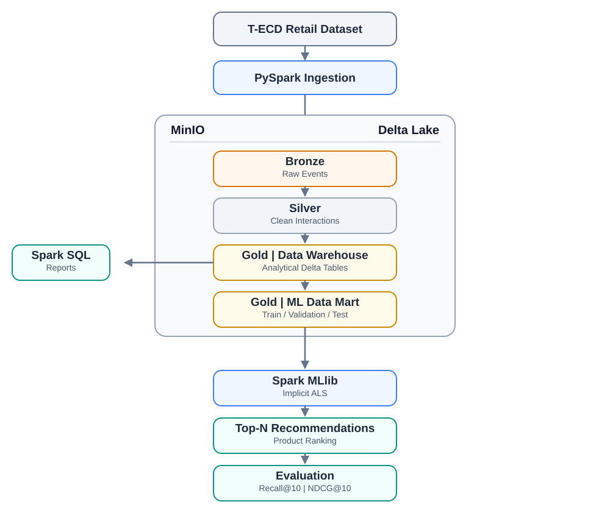

# ĐỀ CƯƠNG TIỂU LUẬN THẠC SĨ

**Môn học:** Khai phá dữ liệu lớn (Big Data Mining)

**Tên đề tài:**

**Ứng dụng kiến trúc Delta Lake và Apache Spark trong xử lý dữ liệu lớn và xây dựng hệ thống gợi ý sản phẩm**

*Tên tiếng Anh: Building a Product Recommendation System Using Delta Lake and Apache Spark*

---

## 1. Giới thiệu đề tài

Hệ thống gợi ý (Recommendation System) hỗ trợ người dùng tìm kiếm sản phẩm phù hợp dựa trên lịch sử tương tác. Để khai thác dữ liệu tương tác một cách nhất quán, đề tài xây dựng quy trình xử lý dữ liệu theo kiến trúc Medallion trên Delta Lake, kết hợp Apache Spark để làm sạch, tổ chức dữ liệu, huấn luyện và đánh giá mô hình gợi ý.

Đề tài tập trung vào **một thuật toán khai phá dữ liệu chính: Implicit Alternating Least Squares (ALS)** của Spark MLlib. Phần dữ liệu được tổ chức thành các bảng Delta theo các lớp Bronze, Silver và Gold; các bảng Gold cung cấp dữ liệu cho phân tích, huấn luyện và đánh giá mô hình.

## 2. Mục tiêu và phạm vi

### 2.1. Mục tiêu

- Xây dựng quy trình thu nhận, làm sạch và biến đổi dữ liệu tương tác người dùng–sản phẩm bằng Apache Spark.
- Tổ chức dữ liệu theo kiến trúc **Medallion (Bronze – Silver – Gold)** với định dạng bảng **Delta Lake**, lưu trên **MinIO**.
- Thiết kế lớp **Gold** để vừa phục vụ truy vấn phân tích, vừa cung cấp dữ liệu đầu vào cho mô hình học máy.
- Triển khai mô hình gợi ý sản phẩm bằng **Implicit ALS** của Spark MLlib.
- Đánh giá chất lượng gợi ý và trình bày kết quả thực nghiệm có thể tái lập.

### 2.2. Phạm vi

- **Dataset:** T-ECD Small, chỉ sử dụng miền Retail tại `dataset/small/retail/`.
- **Loại bài toán:** Gợi ý Top-N sản phẩm dựa trên lịch sử tương tác (implicit feedback).
- **Xử lý dữ liệu:** Batch processing với PySpark và Spark SQL.
- **Lưu trữ:** Delta Tables trên MinIO, không dùng hệ quản trị Data Warehouse riêng.
- **Thuật toán chính:** Implicit ALS.
- **Hình thức trình bày và nộp bài:** Một Jupyter Notebook tích hợp nội dung tiểu luận bằng Markdown, mã PySpark/Spark SQL, bảng kết quả, biểu đồ và nhận xét thực nghiệm.
- **Giới hạn kết luận:** Đề tài là ứng dụng kiến trúc xử lý dữ liệu lớn trên phạm vi Retail đã chọn (khoảng 2,13 GB Parquet nén). Kết luận về hiệu năng chỉ áp dụng cho dữ liệu và tài nguyên thực sự được đo; khả năng mở rộng ra quy mô lớn hơn hoặc cụm nhiều máy không được kiểm chứng trong đề tài.

## 3. Bộ dữ liệu

Đề tài sử dụng **miền Retail của T-ECD Small** để nghiên cứu bài toán gợi ý sản phẩm trong một miền. Phạm vi dữ liệu nguồn là toàn bộ thư mục `dataset/small/retail/`.

Dung lượng tệp nguồn được kiểm tra trên Hugging Face ngày **25/10/2026**:

| Thành phần | Số tệp | Dung lượng (GB thập phân) |
|---|---:|---:|
| Sự kiện tương tác `retail/events/*.pq` | 227 | 1,845 |
| Danh mục sản phẩm `retail/items.pq` | 1 | 0,281 |
| **Tổng Retail** | **228** | **2,126 (khoảng 2,13 GB)** |

Đây là dung lượng Parquet trên đĩa, chưa bao gồm các bảng Delta Bronze/Silver/Gold, dữ liệu trung gian và mô hình. Hai bảng dùng chung `users.pq` và `brands.pq` chỉ được bổ sung nếu cần thuộc tính người dùng hoặc thương hiệu; dung lượng của chúng chưa nằm trong tổng Retail ở trên.

Các trường dữ liệu cần khai thác (tùy theo schema thực tế của bản dữ liệu được chọn):

| Nhóm thông tin | Mục đích |
|---|---|
| Định danh người dùng | Nhận diện người dùng trong lịch sử tương tác |
| Định danh sản phẩm | Nhận diện sản phẩm được tương tác |
| Loại hành vi | Phân biệt các sự kiện tương tác có trong dataset |
| Thời gian sự kiện | Sắp xếp lịch sử và phân chia dữ liệu đánh giá |
| Thuộc tính sản phẩm (nếu có) | Mô tả sản phẩm và hỗ trợ báo cáo |

Trong giai đoạn khảo sát dữ liệu, cần xác minh schema, loại hành vi, số lượng sự kiện/người dùng/sản phẩm, khoảng thời gian, độ phân giải của trường thời gian (theo giây hay theo ngày), mức độ trùng lặp hợp lệ và độ thưa của riêng miền Retail. Quy mô dữ liệu được báo cáo bằng cả số sự kiện lẫn dung lượng, vì dung lượng Parquet nén chưa phản ánh đầy đủ khối lượng xử lý. Các tập con dùng trong thí nghiệm thay đổi quy mô được tạo từ phạm vi Retail này và phải ghi rõ quy tắc lựa chọn.

**Nguồn dữ liệu:** https://huggingface.co/datasets/t-tech/T-ECD

**Thư mục Retail được sử dụng:** https://huggingface.co/datasets/t-tech/T-ECD/tree/main/dataset/small/retail

## 4. Kiến trúc hệ thống

### 4.1. Giải thích kiến trúc

Kiến trúc của đề tài được hiểu theo hai lớp:

- **Lớp lưu trữ vật lý:** toàn bộ dữ liệu Bronze, Silver và Gold đều được lưu dưới dạng **Delta Tables trên MinIO**.
- **Lớp sử dụng dữ liệu:** trong lớp Gold, dữ liệu được tổ chức thành hai nhóm phục vụ hai mục đích khác nhau:
  - **Gold Data Warehouse:** phục vụ truy vấn, thống kê, phân tích dữ liệu bằng Spark SQL.
  - **Gold ML Data Mart:** phục vụ trực tiếp cho bài toán huấn luyện, validation và test mô hình ALS.

**Gold Data Warehouse** và **Gold ML Data Mart** là **hai nhóm bảng trong cùng lớp Gold**, cùng lưu bằng định dạng Delta trên MinIO.

### 4.2. Sơ đồ kiến trúc

*Hình 1. Kiến trúc xử lý dữ liệu Retail của T-ECD Small và xây dựng hệ thống gợi ý sản phẩm. Nhãn “T-ECD Retail Dataset” trong hình chỉ miền Retail của bản Small được chọn trong đề tài.*

[Mở sơ đồ SVG](./architecture.svg). Khi chuyển sang Jupyter Notebook, đặt hình trong Markdown cell ở phần tổng quan hệ thống và giữ tệp `architecture.svg` cùng thư mục với notebook.

**Cách đọc sơ đồ:** Dữ liệu được nạp bằng PySpark vào Bronze, làm sạch ở Silver, rồi tổ chức thành các bảng Gold. Gold Data Warehouse phục vụ truy vấn và báo cáo bằng Spark SQL; Gold ML Data Mart cung cấp các tập dữ liệu cho quy trình huấn luyện, lựa chọn mô hình và đánh giá ALS. Hai nhóm bảng này thuộc *cùng lớp Gold trên MinIO*. Mũi tên giữa các lớp biểu thị các bước xử lý bằng Spark; khung MinIO/Delta Lake biểu thị nơi lưu trữ các bảng. Mô hình chỉ được huấn luyện trên tập dữ liệu được phép dùng, còn validation và test phục vụ lựa chọn tham số và đánh giá theo giao thức đã xác định.

### 4.3. Diễn giải luồng dữ liệu

1. **Dataset nguồn** được nạp vào Spark.
2. Dữ liệu đi qua các lớp **Bronze → Silver → Gold** dưới dạng Delta Tables.
3. Lớp **Gold** gồm hai nhóm bảng theo mục đích sử dụng:
   - **Gold Data Warehouse:** dùng cho truy vấn, thống kê, kiểm tra chất lượng dữ liệu và báo cáo.
   - **Gold ML Data Mart:** dùng để tạo tập `train`, `validation`, `test` và huấn luyện mô hình ALS.
4. Mô hình **Implicit ALS** đọc dữ liệu từ **Gold ML Data Mart** để sinh danh sách gợi ý Top-N.
5. Kết quả cuối cùng bao gồm:
   - các bảng/thống kê phân tích dữ liệu,
   - kết quả gợi ý sản phẩm,
   - các chỉ số đánh giá như Recall@10 và NDCG@10.

### 4.4. Ý nghĩa của từng khối

| Thành phần | Vai trò |
|---|---|
| **Bronze Delta Tables** | Lưu dữ liệu gốc sau khi ingest |
| **Silver Delta Tables** | Lưu dữ liệu đã làm sạch và chuẩn hóa |
| **Gold Data Warehouse** | Nhóm bảng Gold phục vụ truy vấn phân tích |
| **Gold ML Data Mart** | Nhóm bảng Gold phục vụ trực tiếp cho ALS |
| **Implicit ALS** | Thuật toán chính dùng để sinh gợi ý Top-N |
| **Evaluation** | Đánh giá chất lượng mô hình |

## 5. Thiết kế Medallion Architecture

### 5.1. Bronze – Raw Delta Tables

- Tiếp nhận dữ liệu nguồn từ miền Retail của T-ECD Small.
- Giữ nguyên giá trị gốc của sự kiện trong phạm vi dữ liệu đã chọn.
- Bổ sung metadata phục vụ truy vết nguồn và thời điểm nhập dữ liệu.
- Nạp theo batch ngày; khi nạp lại một ngày, chỉ ghi đè đúng phân vùng của ngày đó để không nhân đôi dữ liệu (kiểm chứng ở mục 5.5).
- Đầu ra dự kiến: `bronze.retail_events`.

### 5.2. Silver – Cleaned Delta Tables

- Kiểm tra dữ liệu thiếu hoặc không hợp lệ.
- Chuẩn hóa kiểu dữ liệu, thời gian và loại tương tác.
- Kiểm tra bản ghi trùng thực sự; không xóa các tương tác lặp lại hợp lệ.
- Đầu ra dự kiến: `silver.clean_interactions`.

### 5.3. Gold – Data Warehouse và ML Data Mart

Lớp Gold được chia thành **hai nhóm bảng chức năng**:

#### a) Gold Data Warehouse

Đây là nhóm bảng phục vụ mục đích phân tích và truy vấn dữ liệu. Các bảng này giúp mô tả dữ liệu, thống kê số lượng tương tác, số người dùng, số sản phẩm và phục vụ báo cáo.

| Bảng | Nội dung | Mục đích |
|---|---|---|
| `gold.fact_interactions` | Dữ liệu sự kiện đã chuẩn hóa ở mức từng tương tác | Bảng fact trung tâm để truy vấn và phân tích |
| `gold.dim_products` | Thông tin mô tả sản phẩm (nếu có) | Hiển thị, thống kê và báo cáo |
| `gold.dim_event_types` | Danh mục loại tương tác | Chuẩn hóa ý nghĩa hành vi |
| `gold.dim_dates` | Thông tin ngày/thời gian | Hỗ trợ phân tích theo thời gian |

#### b) Gold ML Data Mart

Đây là nhóm bảng được xây riêng từ Gold để phục vụ trực tiếp cho bài toán recommendation. Nhóm bảng này không nhằm mục đích báo cáo, mà nhằm chuẩn bị dữ liệu đúng định dạng cho ALS.

| Bảng | Nội dung | Mục đích |
|---|---|---|
| `gold_ml.user_index`, `gold_ml.item_index` | Ánh xạ ID gốc sang chỉ số nguyên | Định dạng đầu vào bắt buộc của ALS |
| `gold_ml.train_set` | Sự kiện trong cửa sổ lịch sử train, kết thúc trước đầu cửa sổ validation ít nhất 12 giờ | Nguồn tổng hợp đầu vào cho ALS và Popularity |
| `gold_ml.train_user_item` | Tổng hợp user–item có trọng số, tính chỉ từ `train_set` | Đầu vào fit ALS khi chọn tham số |
| `gold_ml.validation_set` | Các cặp user–item positive trong cửa sổ validation | Nhãn để chọn tham số (E2) |
| `gold_ml.trainval_user_item` | Tổng hợp user–item từ lịch sử train + validation, kết thúc trước đầu cửa sổ test ít nhất 12 giờ | Đầu vào huấn luyện lại ALS trước đánh giá cuối |
| `gold_ml.test_set` | Các cặp user–item positive trong cửa sổ test | Nhãn để đánh giá cuối (E1) |

Mỗi bảng tổng hợp user–item đều gắn với một mốc cắt thời gian. Không có bảng tổng hợp trên toàn bộ dữ liệu được dùng làm đầu vào cho mô hình, để tránh rò rỉ thông tin từ cửa sổ đánh giá.

### 5.4. Quan hệ giữa Gold Data Warehouse và Gold ML Data Mart

Quan hệ giữa hai nhóm bảng được mô tả như sau:

- **Gold Data Warehouse** là lớp dữ liệu đã được chuẩn hóa và sẵn sàng cho phân tích.
- Từ đó, Spark tiếp tục biến đổi dữ liệu để tạo ra **Gold ML Data Mart**.
- **ALS không đọc trực tiếp toàn bộ `fact_interactions`**, mà chỉ được fit trên bảng tổng hợp user–item của lịch sử được phép dùng: `train_user_item` khi chọn tham số và `trainval_user_item` khi huấn luyện lại trước đánh giá cuối.
- `validation_set` và `test_set` chỉ chứa nhãn để đánh giá, không phải dữ liệu huấn luyện. Vai trò của từng tập được quy định ở mục 8.2.

Vì vậy, luồng hợp lý là:

**Silver → Gold Data Warehouse → Gold ML Data Mart → ALS**

Điều này giúp kiến trúc rõ ràng hơn so với việc xem Gold là một khối duy nhất.

### 5.5. Kiểm chứng vai trò của Delta Lake

Các kiểm tra sau minh chứng những tính năng Delta Lake thực sự được dùng trong pipeline. Đây không phải câu hỏi nghiên cứu riêng; kết quả được trình bày thành bảng đạt/không đạt trong notebook.

| Kiểm tra | Cách thực hiện | Kết quả mong đợi |
|---|---|---|
| Nạp lại không nhân đôi | Nạp lại cùng một batch ngày vào Bronze bằng `replaceWhere` theo cột ngày (hoặc `MERGE` nếu xác định được khóa duy nhất) | Số dòng của bảng không đổi sau lần nạp thứ hai |
| Cố định phiên bản dữ liệu | Ghi lại số phiên bản các bảng Silver/Gold dùng cho thực nghiệm; đọc lại bằng `versionAsOf` | Số dòng và schema trùng với lần chạy thực nghiệm |
| Lịch sử thay đổi | `DESCRIBE HISTORY` trên các bảng chính | Thấy được các lần ghi và thao tác tương ứng |
| Ràng buộc schema | Thử ghi thêm một batch có kiểu cột sai vào Silver | Lệnh ghi bị từ chối, bảng không thay đổi |

## 6. Phương pháp khai phá dữ liệu: Implicit ALS

### 6.1. Bài toán

Từ tập tương tác đã quan sát giữa người dùng và sản phẩm, xây dựng hệ thống đề xuất Top-N sản phẩm mà người dùng có thể quan tâm.

### 6.2. Thuật toán

Sử dụng **Implicit Alternating Least Squares (ALS)** của Spark MLlib. Dữ liệu đầu vào được tổng hợp theo cặp người dùng–sản phẩm và biểu diễn mức độ tương tác; cách tạo trọng số được xác định từ các hành vi thực sự có trong dataset và được kiểm tra bằng tập validation.

ALS học các nhân tố ẩn của người dùng và sản phẩm để sinh điểm ưu tiên và danh sách gợi ý. Đề tài không xây dựng hoặc sửa đổi thuật toán ALS.

### 6.3. Quy trình mô hình hóa

1. Đọc dữ liệu sự kiện từ **Gold Data Warehouse** bằng Spark để xây dựng **Gold ML Data Mart**.
2. Phân chia sự kiện theo thời gian thành lịch sử train, cửa sổ validation và cửa sổ test, giữ gap tối thiểu 12 giờ trước đầu mỗi cửa sổ đánh giá (mục 8.1); bảo đảm không sử dụng thông tin tương lai trong quá trình học.
3. Tạo dữ liệu implicit feedback và tổng hợp user–item chỉ từ lịch sử được phép dùng tại mỗi mốc đánh giá; lưu các bảng thuộc **Gold ML Data Mart**.
4. Fit ALS trên `train_user_item`; chọn tham số và trọng số hành vi bằng `validation_set`.
5. Huấn luyện lại một lần với cấu hình đã chọn trên `trainval_user_item`.
6. Sinh danh sách Top-10 trên toàn bộ item ứng viên theo giao thức chính (cho phép gợi ý lại item đã mua) và giao thức phụ (loại item đã tương tác trong lịch sử).
7. Đánh giá một lần trên `test_set` đã cố định.

## 7. Câu hỏi nghiên cứu

- **RQ1:** Mô hình Implicit ALS có tạo ra kết quả gợi ý tốt hơn phương pháp gợi ý sản phẩm phổ biến (Popularity Baseline) hay không?
- **RQ2:** Các tham số của ALS ảnh hưởng như thế nào tới chất lượng danh sách gợi ý?
- **RQ3:** Khi tăng lượng dữ liệu tương tác được xử lý, thời gian thực thi của pipeline Spark thay đổi như thế nào?

## 8. Thiết kế thực nghiệm và đánh giá

| Thí nghiệm | Nội dung | Kết quả cần báo cáo |
|---|---|---|
| E1 | So sánh Popularity Baseline và Implicit ALS trên test | Recall@10, NDCG@10 theo giao thức chính và phụ; số user được đánh giá, tỷ lệ cold-start |
| E2 | Khảo sát một số cấu hình tham số ALS trên validation | Chất lượng gợi ý và thời gian huấn luyện theo cấu hình |
| E3 | Thực hiện pipeline với các quy mô dữ liệu theo mục 8.3 | Thời gian ETL và huấn luyện (trung vị, min–max); thống kê tác vụ Spark |

### 8.1. Giao thức đánh giá

Các quy tắc dưới đây là phương án đã chốt. Những giá trị chỉ xác định được sau khi khảo sát dữ liệu (tên chính xác của hành vi, mốc ngày) được ghi tại phần cấu hình của notebook và giữ cố định trước khi xem kết quả test.

| Thành phần | Quy tắc |
|---|---|
| Positive interaction | Sự kiện mua hàng hoàn tất (`order`/`transaction`; tên chính xác của `action_type` được xác nhận khi khảo sát). Các hành vi khác như thêm vào giỏ chỉ dùng làm tín hiệu đầu vào cho ALS, không dùng làm nhãn đánh giá. |
| Chia theo thời gian | Ba khoảng liên tiếp: lịch sử train, cửa sổ validation, cửa sổ test. Mặc định test là 14 ngày cuối và validation là 14 ngày liền trước; độ dài có thể điều chỉnh sau khảo sát nếu một cửa sổ có quá ít user được đánh giá. |
| Gap 12 giờ | Theo yêu cầu của T-ECD, sự kiện lịch sử phải cách thời điểm dự đoán tối thiểu 12 giờ, cho cả huấn luyện và kiểm thử. Sự kiện trong 12 giờ ngay trước đầu cửa sổ validation và đầu cửa sổ test không thuộc lịch sử của mốc đó. Nếu trường thời gian chỉ có độ phân giải theo ngày, gap được làm tròn thành 1 ngày. |
| Tập ứng viên | Toàn bộ item xuất hiện trong lịch sử được phép dùng; xếp hạng trên toàn bộ tập này, không lấy mẫu ứng viên. Item chỉ xuất hiện trong cửa sổ đánh giá không thể được gợi ý và được thống kê riêng. |
| Quy tắc mua lại | Giao thức chính cho phép gợi ý lại item user đã mua, vì mua lặp là hành vi phổ biến trong Retail. Giao thức phụ loại các item user đã tương tác trong lịch sử, để đánh giá khả năng gợi ý sản phẩm mới. Cả ALS và Popularity được đánh giá theo cả hai giao thức. |
| User đủ điều kiện | Có ít nhất một positive trong cửa sổ đánh giá và ít nhất một tương tác trong lịch sử được phép dùng. |
| Cold-start | User không có lịch sử không được tính vào chỉ số chính; báo cáo số lượng và tỷ lệ của nhóm này. Popularity Baseline được đánh giá riêng trên nhóm cold-start để tham khảo. |
| Chỉ số | Relevance nhị phân: item là relevant nếu user có positive với item đó trong cửa sổ đánh giá. Chỉ số được lấy trung bình trên các user đủ điều kiện. |

Giao thức áp dụng giống nhau cho ALS và Popularity Baseline. Không xem mọi sản phẩm chưa tương tác là phản hồi âm đã được quan sát.

### 8.2. Vai trò của train, validation và test

- **Train:** dữ liệu duy nhất dùng để fit ALS và tính điểm Popularity trong giai đoạn chọn tham số.
- **Validation:** chỉ dùng để so sánh cấu hình (E2) và chọn trọng số hành vi; không dùng để fit mô hình trong giai đoạn này.
- **Huấn luyện lại trước test:** sau khi chốt cấu hình, ALS được huấn luyện lại một lần trên lịch sử train + validation với cùng cấu hình, vẫn giữ gap 12 giờ trước đầu cửa sổ test; điểm Popularity cũng được tính lại trên cùng lịch sử.
- **Test:** chỉ dùng một lần để đánh giá cuối (E1); không chọn tham số hay điều chỉnh quy tắc sau khi xem kết quả test.

### 8.3. Thiết kế E3

| Thành phần | Quy tắc |
|---|---|
| Tập con | Lấy theo số ngày liên tiếp tính từ ngày đầu của phạm vi Retail: 25%, 50%, 75% và 100% số ngày. Không lấy mẫu ngẫu nhiên sự kiện, để giữ cấu trúc thời gian và lịch sử của user. |
| Cấu hình cố định | Cùng máy, cùng cấu hình Spark (số core, bộ nhớ driver/executor, `spark.sql.shuffle.partitions`) và cùng cấu hình ALS đã chọn ở E2 (`rank`, `regParam`, `alpha`, `maxIter`) cho mọi quy mô. |
| Phạm vi đo | Thời gian từng giai đoạn ETL (Bronze, Silver, Gold) và thời gian huấn luyện ALS; đo khi action của Spark hoàn tất (ghi bảng hoặc `count`), không đo các phép biến đổi lười. |
| Số lần lặp và cache | Mỗi quy mô chạy 3 lần. Lần chạy đầu sau khi khởi động lại Spark session (cache lạnh) được báo riêng; cách dùng `cache()`/`persist()` giống nhau ở mọi quy mô. |
| Kết quả báo cáo | Số dòng, dung lượng bảng, trung vị và khoảng min–max thời gian của mỗi giai đoạn; biểu đồ thời gian theo quy mô; minh chứng Spark UI cho quy mô 100%. |

Kết luận của E3 chỉ áp dụng cho dữ liệu Retail và tài nguyên đã đo; không ngoại suy cho quy mô lớn hơn hoặc cụm nhiều máy.

### 8.4. Các chỉ số đánh giá

- **Recall@10:** số item relevant khác nhau xuất hiện trong Top-10 chia cho tổng số item relevant khác nhau của user trong cửa sổ đánh giá; sau đó lấy trung bình trên các user đủ điều kiện. Định nghĩa theo [Spark RankingMetrics](https://spark.apache.org/docs/latest/api/python/reference/api/pyspark.mllib.evaluation.RankingMetrics.html#pyspark.mllib.evaluation.RankingMetrics.recallAt).
- **NDCG@10:** chất lượng thứ hạng của danh sách Top-10, dùng gain nhị phân.
- **Training time / ETL time:** thời gian thực hiện các giai đoạn trong pipeline, đo theo mục 8.3.

## 9. Kết quả dự kiến

- Một pipeline PySpark xử lý dữ liệu theo ba lớp Bronze, Silver và Gold dưới dạng Delta Tables trên MinIO.
- Các bảng Gold được tổ chức thành **Gold Data Warehouse** và **Gold ML Data Mart**.
- Mô hình Implicit ALS có thể sinh danh sách Top-N gợi ý sản phẩm.
- Bảng và biểu đồ đánh giá Recall@10, NDCG@10; so sánh với Popularity Baseline.
- Một Jupyter Notebook đóng vai trò bài tiểu luận hoàn chỉnh, tích hợp giải thích phương pháp, code, kết quả thực nghiệm và minh chứng từ Spark UI.
- Các nhận xét, kết luận, giới hạn nghiên cứu và tài liệu tham khảo được viết trực tiếp trong Markdown cell của notebook.

## 10. Bố cục trình bày trên Jupyter Notebook

Notebook là sản phẩm trình bày chính của tiểu luận, dự kiến đặt tên `tieu_luan_retail_als.ipynb`. Nội dung được tổ chức theo tiến trình xử lý và thực nghiệm, có thể đọc và chạy lần lượt từ trên xuống dưới.

### 10.1. Thứ tự các phần

| Phần trong notebook | Nội dung Markdown | Code và kết quả cần trình bày |
|---|---|---|
| **0. Thông tin bài tiểu luận và tóm tắt** | Tên đề tài, môn học, học viên/nhóm, giảng viên, mục lục; tóm tắt mục tiêu và kết quả chính. Phần kết quả tóm tắt chỉ hoàn thiện sau khi chạy thực nghiệm. | Không cần code. |
| **1. Bài toán, mục tiêu và phạm vi** | Bài toán gợi ý Top-N; phạm vi T-ECD Small Retail; các câu hỏi RQ1–RQ3; giới thiệu E1–E3. | Không cần code. |
| **2. Cơ sở phương pháp và kiến trúc** | Giải thích ngắn gọn Spark, Delta Lake, MinIO, Medallion; vai trò Gold Data Warehouse và Gold ML Data Mart; nguyên lý implicit feedback và ALS. Đặt sơ đồ kiến trúc tại đây. | Không cần code; dùng sơ đồ và bảng vai trò các thành phần. |
| **3. Môi trường và cấu hình thực nghiệm** | Yêu cầu chạy notebook, phiên bản thư viện, cấu hình máy/Spark, đường dẫn dữ liệu và nơi lưu kết quả. | Import thư viện, khai báo tham số chung và seed, khởi tạo Spark, kiểm tra kết nối MinIO; hiển thị phiên bản và cấu hình thực tế. |
| **4. Dữ liệu nguồn và khảo sát ban đầu** | Nguồn và phiên bản dataset, phạm vi Retail, dung lượng, ý nghĩa các trường sau khi xác minh schema. | Đọc Parquet, xem schema và một số bản ghi; thống kê thời gian, sự kiện, user, item, hành vi, null và trùng lặp. |
| **5. Bronze — Thu nhận dữ liệu** | Mục tiêu giữ dữ liệu gốc, metadata truy vết và quy tắc nạp lại dữ liệu theo batch ngày. | Ghi/đọc bảng Delta Bronze; đối chiếu số bản ghi, schema và thông tin phiên bản bảng; chạy các kiểm tra Delta Lake ở mục 5.5 (nạp lại không nhân đôi, `versionAsOf`, `DESCRIBE HISTORY`, ràng buộc schema) và trình bày bảng đạt/không đạt. |
| **6. Silver — Làm sạch và chuẩn hóa** | Giải thích từng quy tắc xử lý thiếu, sai kiểu, thời gian và bản ghi trùng; phân biệt tương tác lặp hợp lệ. | Biến đổi dữ liệu, ghi Silver, lập bảng số bản ghi trước/sau mỗi bước và kết quả kiểm tra chất lượng. |
| **7. Gold Data Warehouse — Phân tích dữ liệu** | Thiết kế fact/dimension và các câu hỏi mô tả dữ liệu phục vụ mô hình. | Xây bảng Gold; truy vấn Spark SQL; biểu đồ tương tác theo thời gian, loại hành vi, mức hoạt động user và độ phổ biến item; nhận xét độ thưa và phân bố. |
| **8. Gold ML Data Mart — Thiết kế đánh giá và chuẩn bị dữ liệu** | Trình bày giao thức đánh giá theo mục 8.1–8.2 của đề cương: positive interaction, trọng số hành vi, mốc chia thời gian, gap 12 giờ, tập ứng viên, quy tắc mua lại, user đủ điều kiện, cold-start và công thức Recall@10/NDCG@10; ghi các giá trị đã xác nhận sau khảo sát. | Chia sự kiện trước khi tổng hợp user–item; tạo ánh xạ ID, `train_user_item`, `trainval_user_item` và các tập nhãn validation/test; kiểm tra lịch sử luôn kết thúc trước đầu cửa sổ đánh giá ít nhất 12 giờ; thống kê từng tập và số user/item chưa thấy trong lịch sử. |
| **9. Xây dựng Popularity Baseline** | Định nghĩa điểm phổ biến và lý do chọn baseline; xác định dữ liệu lịch sử được phép sử dụng. | Tính điểm từ train, sinh Top-N, kiểm tra hàm tính chỉ số trên ví dụ nhỏ và đánh giá trên validation. |
| **10. Huấn luyện và lựa chọn ALS — E2** | Giải thích các tham số khảo sát và tiêu chí chọn mô hình bằng validation. | Fit các cấu hình trên `train_user_item`, lưu thời gian và chỉ số validation; bảng/biểu đồ so sánh; chốt cấu hình trước khi đánh giá test. |
| **11. Đánh giá cuối và minh họa gợi ý — E1** | Mô tả giao thức test chung cho ALS và Popularity; trả lời RQ1, phân tích trường hợp mô hình tốt hoặc chưa tốt. | Huấn luyện lại một lần trên `trainval_user_item`; đánh giá một lần trên test cố định theo giao thức chính và phụ; bảng/biểu đồ Recall@10 và NDCG@10; số user được đánh giá, tỷ lệ cold-start; một vài ví dụ Top-N kèm lịch sử phù hợp. |
| **12. Hiệu năng xử lý theo quy mô — E3** | Quy tắc tạo tập con, cấu hình tài nguyên và ALS cố định, số lần lặp và trạng thái cache theo mục 8.3; phạm vi kết luận về hiệu năng. | Đo ETL/training khi Spark hoàn tất thực thi; bảng số dòng/dung lượng, trung vị và min–max thời gian; biểu đồ thời gian theo quy mô và minh chứng Spark UI. |
| **13. Thảo luận và kết luận** | Trả lời lần lượt RQ1–RQ3 bằng kết quả đã đo; đánh giá mức đạt mục tiêu, hạn chế và hướng phát triển. Phân biệt kết quả trên Retail đã chọn với khả năng mở rộng chưa được kiểm chứng. | Bảng tổng hợp kết quả đã có; không chạy thêm quá trình chọn mô hình tại đây. |
| **14. Tài liệu tham khảo và hướng dẫn tái lập** | Dẫn nguồn dataset, thuật toán, Spark/Delta Lake; hướng dẫn chuẩn bị dữ liệu, môi trường và chạy notebook; mô tả các tệp đi kèm. | Liệt kê đường dẫn cấu hình, bảng Delta/phiên bản dữ liệu và kết quả đã lưu để truy vết thực nghiệm. |

### 10.2. Cách trình bày trong từng phần thực hành

Mỗi bước có cấu trúc **Mục đích → Code → Kết quả → Nhận xét**:

1. **Markdown trước code:** Nêu bước này giải quyết việc gì, lý do chọn cách làm và giả định liên quan.
2. **Code cell:** Mỗi cell thực hiện một tác vụ rõ ràng; tách xử lý dữ liệu, tính chỉ số và vẽ biểu đồ.
3. **Output:** Hiển thị bảng hoặc biểu đồ cần thiết để kiểm chứng bước xử lý; giới hạn số dòng xem trước.
4. **Markdown sau output:** Giải thích số liệu quan sát được và ảnh hưởng tới bước tiếp theo; không chỉ lặp lại tên biểu đồ.

Lý thuyết tổng quan đặt ở phần 2; công thức và quy tắc chi tiết đặt sát phần code áp dụng. Các kết luận thực nghiệm phải dựa trên output đã chạy, không điền sẵn kết quả dự kiến như kết quả thực tế.

### 10.3. Quy tắc chạy lại và hoàn thiện notebook

- Tập trung đường dẫn, seed, mốc thời gian, tham số ALS và cấu hình thực nghiệm tại phần 3; giải thích ý nghĩa của chúng ở phần tương ứng.
- Đọc thông tin xác thực MinIO từ biến môi trường; không lưu khóa truy cập trong cell hoặc output.
- Xử lý dữ liệu đầy đủ bằng Spark; chỉ đưa bảng tổng hợp hoặc mẫu nhỏ về Python để vẽ biểu đồ.
- Lưu kết quả E1–E3 thành bảng có cấu hình đi kèm; biểu đồ và bảng tóm tắt đọc từ các kết quả này.
- Ghi rõ phiên bản nguồn dữ liệu và các bảng Delta được sử dụng; quy tắc ghi bảng phải cho phép chạy lại mà không nhân đôi dữ liệu ngoài ý muốn.
- Trước khi nộp, thực hiện **Restart Kernel and Run All** trong môi trường đã chuẩn bị; kiểm tra thứ tự cell và lưu notebook với output cần đọc.
- Kiểm tra sơ đồ, bảng, biểu đồ và liên kết khi mở lại notebook. Ghi rõ bước chưa chạy hoặc phụ thuộc còn thiếu nếu chưa thể chạy toàn bộ.

## 11. Tài liệu tham khảo chính

- T-ECD Dataset: https://huggingface.co/datasets/t-tech/T-ECD
- Delta Lake Documentation: https://docs.delta.io/
- Databricks Medallion Architecture: https://docs.databricks.com/aws/en/lakehouse/medallion
- Apache Spark Collaborative Filtering: https://spark.apache.org/docs/latest/ml-collaborative-filtering.html
- Apache Spark SQL: https://spark.apache.org/docs/latest/sql-programming-guide.html

---

**Phạm vi đã thống nhất:** T-ECD Small — chỉ miền Retail (khoảng 2,13 GB Parquet nguồn) → Delta Lake (Bronze → Silver → Gold) trên MinIO → Gold Data Warehouse / Gold ML Data Mart → Spark MLlib Implicit ALS → Evaluation.
